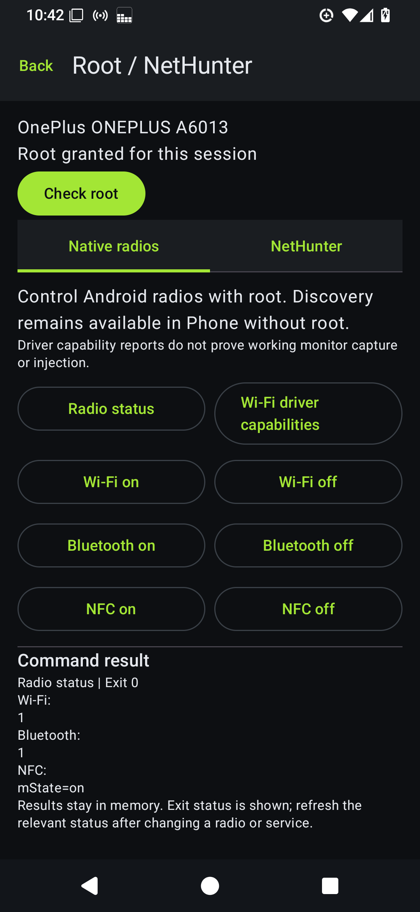
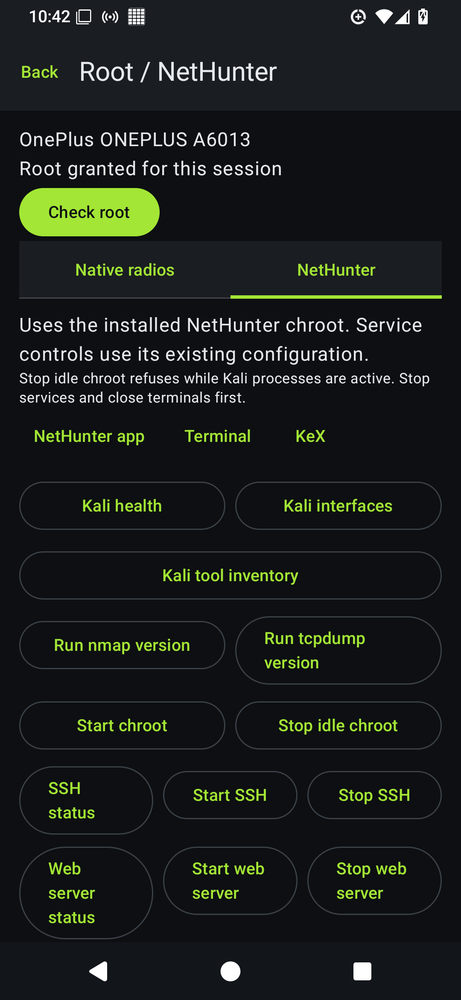

# Native phone and NetHunter validation

This contribution includes the non-root Android implementation as well as optional root/NetHunter controls. The stock-phone path is app/src/main/java/com/swp81x/nrsuite/PhoneHardwareActivity.kt and core/hardware/PhoneHardwareViewModel.kt. Root is requested only through the separate control panel.

## Source and APK provenance

- Base feature work: v1.0.0-beta.3.1.2, b83d825983c6c2c595d5660821c87f0e00f0f2c1.
- PR base: upstream main at d859b32898610029c743a2e66dbb92057cc30535. Its Git tree is identical to the tested 3.1.2 release tree; only history differs.
- Publication APK SHA-256: 26282e8b269335bc4723ad673f54d717755be9b5e8550d50f702b814b0c21246.
- Package: com.swp81x.nrsuite.nativepreview; label: NRSuite Native Test; version: 1.0.0-beta.3.1.2-native-preview. Debug-signed contributor build, distributed separately from upstream's release APK.
- Final APK was tested on the rooted OnePlus. The Samsung pass used an earlier native-discovery-only APK, SHA-256 e5107d8fb295486c3b0e2d49974a5390c9b5bc93228d9f3a81ca2cbdfba1b87f. It predates the root/NetHunter panel. The same non-root discovery source is included in this PR and final APK, but the final combined APK was not reinstalled on the Samsung during the rooted pass.

The earlier combined-root snapshot used APK e31aa7b01d63820a02f1099e70cbab9c4a1e8ea689747f10121120dfb917762b. The publication build adds only the NFC status filter output fix; app root/radio status, absence of the broken-pipe message, and Kali health were smoke-tested again on the OnePlus. Historical snapshot hashes are retained. APK DEX inspection confirms both the non-root Phone activity/ViewModel and root control activity/ViewModel are present.

## Automated checks

- assembleDebug: passed.
- testDebugUnitTest: 130 tests in 40 suites; zero failures, errors or skipped tests.
- Four new policy tests cover non-root command refusal, idle-stop guard ordering/no deletion or force kills, service action effects/allowlist, and quoting of Kali shell variables.
- The other 126 tests are existing suite results. They do not establish complete coverage of the added Android APIs.
- All 25 generated root scripts passed Android sh -n syntax checks. This does not execute or validate all state-changing operations.
- No line/branch coverage percentage was measured. No new instrumented Android test suite was added; device coverage below is manual/ADB-driven UI evidence.
- Android lint: passed, zero errors/fatals; 102 warnings and 18 hints reported. Two entries point to added files: StaticFieldLeak on an application-context property in AndroidViewModel, and a UseKtx suggestion for Uri parsing. No baseline differential lint run was performed.

## Device coverage matrix

| Behavior | Non-root Samsung | Rooted NetHunter OnePlus | Remaining limits |
| --- | --- | --- | --- |
| Hardware | SM-S711U, Android 16/API 36 | OnePlus 6T/A6013, Android 15/API 35, kernel 4.9.337+ | Two devices only |
| Launch without ESP32 | Passed | Passed | No ESP32 runtime regression pass |
| Wi-Fi access-point discovery | Passed; at least 3 visible rows | Not rerun as a discovery pass | Cached/throttle and disabled-radio edge cases incomplete |
| BLE advertisements | Passed; 12 distinct visible rows | Not rerun as a discovery pass | Not a complete Bluetooth Classic inventory |
| Permission denial/retry | Passed | App root denial then explicit Magisk approval passed | Older API levels not device-tested |
| Foreground scan/reader cleanup | Passed after settled settings transition | Root commands bounded separately | Process deadline and arbitrary service daemon lifetime are different |
| NFC reader startup | Passed | Native radio off/on control passed | No physical tag read |
| Root native radio control | Not applicable | Wi-Fi/Bluetooth/NFC on returned exit 0; NFC off/on states verified | Wi-Fi/Bluetooth off not executed; Wi-Fi off cancelled |
| Driver report | Not applicable | iw capability report returned; monitor advertised | No monitor capture or injection implementation/acceptance |
| Kali execution | Not applicable | UID 0 health, interfaces, tool inventory, nmap version passed | tcpdump version button provided but not device-executed |
| Chroot start | Not applicable | Already-mounted guard passed | Fresh unmounted initialization untested |
| Chroot stop | Not applicable | Busy guard returned exit 23 before unmount | Successful idle unmount untested |
| Services | Not applicable | SSH status and already-running start passed | SSH stop and Apache/PostgreSQL cycles untested |
| NetHunter/terminal/KeX launchers | Not applicable | Expected foreground packages reached | No desktop server startup/connection test |

SM-S711U is the Galaxy S23 FE model listed in [Samsung's official model/update documentation](https://doc.samsungmobile.com/SM-S711U/036335251203/eng.html). The device label should not be read as a test of every Galaxy S23 variant.

## Evidence and reproduction

- [Non-root Samsung snapshot](../test-artifacts/native-phone-sm-s711u.json), captured before root controls were added. Pending-root fields in that historical snapshot are superseded by the separate OnePlus record.
- [Rooted NetHunter snapshot](../test-artifacts/native-nethunter-oneplus6t.json), including final APK smoke and preserved radio/SSH state.
- [Machine-readable test summary](../test-artifacts/native-phone-coverage.json).
- [Capabilities, permission behavior and acceptance steps](NATIVE-PHONE-HARDWARE.md).

Build with JDK 21, Android SDK 36 and NDK 30.0.16248370:

```text
./gradlew :app:assembleDebug :app:testDebugUnitTest --no-daemon -Pkotlin.compiler.execution.strategy=in-process
./gradlew :app:lintDebug --no-daemon -Pkotlin.compiler.execution.strategy=in-process
```

On PowerShell, quote the dotted -Pkotlin.compiler.execution.strategy=in-process argument. No signing secrets are needed for the debug preview. Grant Android discovery permissions as requested; grant superuser access only when selecting Check root. Kali must already be installed under the supported /data/local/nhsystem layout. Service actions use its existing configuration, including network bind settings.

Raw nearby SSIDs, BSSIDs, BLE identifiers, device serials, app inventories, credentials and full UI dumps are excluded from the contribution. Device evidence records outcomes and counts. The source can display discovered identifiers locally to the user, but does not persist scan results.

## Screenshots





[Publication candidate smoke record](../test-artifacts/native-phone-publication-smoke.json). The validation release ZIP contains sanitized JUnit cases and a lint issue summary; hostnames and captured standard output/error are omitted.
